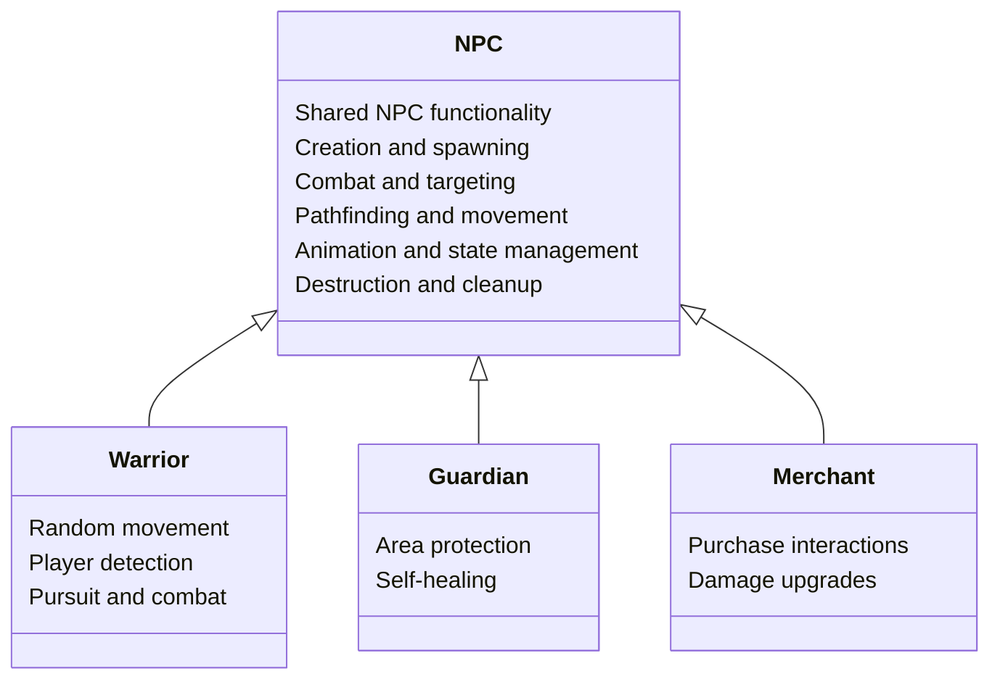

# Roblox-NPC-Combat-Framework

This project includes 2 interconnected systems/modules: an NPC Framework and a Combat System. Both follow an Object-Oriented Programming (OOP) design.

## It includes:
- NPC inheritance
- Pathfinding
- Projectiles and projectile abilities
- Blocking, parrying, dashing and stun
- NPC healing
- Player state management
- Player vs Player and Player vs NPC combat

The NPC system is designed around a main NPC object, with inherited objects from it: Warrior, Guardian and Merchant. They share the same base NPC functionality while having their own specific behaviours and functions.

- **Warrior:** Walks around randomly until it detects a player within a reasonable distance. It then pathfinds towards the player and attacks. Drops coins when defeated.
- **Guardian:** Protects a designated area and heals when damaged, making it very difficult to defeat with the player's starting damage.
- **Merchant:** Allows players to purchase a damage upgrade using collected coins.

The base NPC object contains the shared functionality used by all NPC types, including creation, spawning, combat, targeting, pathfinding, animations, state management and destruction. The inherited objects reuse this functionality and extend or override it where necessary.

## NPC Inheritance Structure

## Combat System

The combat system handles both player vs player and player vs NPC combat. It includes hit detection, damage handling, projectiles, projectile abilities, blocking, parrying, dashing and player state management.

## Projectiles

Projectiles and projectile abilities work under a queue data structure, the 3 abilities (enlarge, split and homing) affect the first thrown projectiles when the ability is activated, so if projectile 1 is thrown then projectile 2 afterwards and  the user activates 2 abilities, the first ability activated will affect projectile 1 and the second affects 2 and so on.

## Used
- Luau
- Roblox Studio as my game engine
- Services such as PathfindingService and ContextActionService
- RemoteEvents for communication between the client and server
